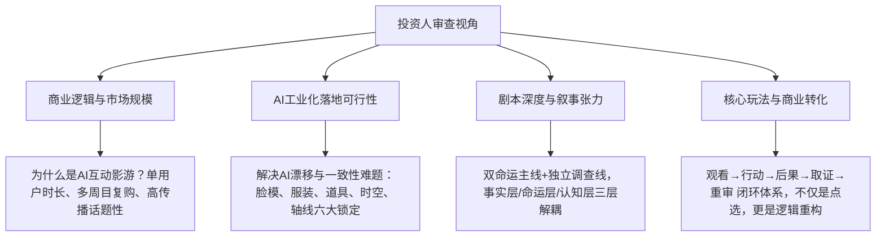

# AI影视与互动影游投资提案网页开发规范 (AGENT.md)

本文件定义了针对 **AI影视剧 / 互动影游项目** 的数字化投资人提案（Web Pitch Deck）设计标准、内容转化流程、投资人心理模型以及后续资产接入规范。本项目设计为**纯静态网站（零依赖）**，天然完美适配 **Vercel**、**Cloudflare Pages**、**GitHub Pages** 等平台的一键部署与全球极速分发。

---

## 1. 核心定位与投资人认知模型

面向投资人的提案（Pitch Deck）与一般面向终端玩家的宣发官网存在本质区别。投资人关注的核心维度包括：



### 1.1 关键说服力要素
1. **视觉第一印象（Cinematic Impact）**：电影级视觉调性（Cyber-Noir / 悬疑现实主义），开门见山展示项目气质。
2. **直观可体验的原型（Playable Prototype）**：不仅用文字介绍玩法，更直接在网页中内置**微型交互演示器**（如分支试玩、双重监控证据交叉比对）。
3. **确定性与风控实证（Feasibility Proofs）**：明确 AI 制作阶段的“可用分钟成本”、证据闭环表与交付里程碑，击碎投资人对“AI产出不可控”的顾虑。

---

## 2. 页面信息架构与叙事节奏

页面采用**“自顶向下、由宏观概念到微观交互再到商业交付”**的递进式设计：

| 模块序号 | 模块名称 | 面向投资人的核心传递信息 |
| :--- | :--- | :--- |
| **00** | **Hero 悬念开篇** | 项目名称、Slogan、核心命题、沉浸式电影级海报与主创出品信息 |
| **01** | **Concept 项目概念** | 双命运主线 + 关键调查视角架构、AI影视片段+互动影游的产品形态 |
| **02** | **Story 故事与命题** | 核心案情递进（相遇→指控→前因→重审）、伦理困境（“被冤枉者是否会伤害另一个无辜者”） |
| **03** | **Characters 核心角色网络** | 4大核心人物立绘、角色身份、掌握信息碎片与人物关系拓扑图 |
| **04** | **Chapter Map 12章全景地图** | 1-6章（危机与起因）、7-12章（逃亡、重审与终局）的双主线交织脉络 |
| **05** | **Perspectives 多重视角机制** | 周放、阿溟、安冉三大视角的信息差设计，以及林亦雯的关键选择权 |
| **06** | **Game System 玩法闭环** | 5步闭环：观看 → 行动 → 后果 → 取证 → 重审，底层节点状态机设计 |
| **07-08** | **Interactive Prototype 分支试玩** | 可点击互动的第1章“酒吧风波”决策器（A/B/C走向实时推演） |
| **09** | **Evidence Lab 证据重构实验室** | 交互式第11章“两个周放”矛盾监控比对台，体验核心证据重审玩法 |
| **10-11** | **Logic & Endings 多结局逻辑** | 事实层、命运层、认知层三层分离，保全悬疑叙事公平性与二周目动力 |
| **12** | **Visual Identity 视听风格与AI工业规范** | 黑·红·黄影调定义、现实主义参考，以及AI生产六大一致性锁定规范 |
| **13** | **Roadmap & Delivery 交付承诺** | 商业化路径、三大实证交付清单（证据闭环表、样章、分钟成本）及投资联系 |

---

## 3. 技术栈与工程规范 (Vercel Ready)

### 3.1 零依赖纯静态架构
- **HTML5**: 语义化结构，无外部庞大框架依赖，保证任何浏览器即开即看。
- **CSS3 (Modern Design System)**:
  - 调色板：深黑冷底 (`#0A0B0E`, `#12151C`) + 警示红/命运红 (`#E53935`, `#FF4757`) + 调查琥珀黄 (`#FFAA00`, `#F59E0B`) + 证据科技青 (`#00E5FF`)。
  - 玻璃拟态（Glassmorphism）、微噪点纹理（Cinematic Grain）、渐变光晕与动态线条。
- **Vanilla JavaScript**:
  - 轻量、高性能，实现分支选择树状态切换、证据台左右滑动与放大比对、章节时间线切换、响应式导航。
- **Vercel 部署配置**:
  - 根目录提供 `vercel.json`，支持一键部署到 Vercel CDN，全球访问超低延迟。

---

## 4. 后续素材接入规范 (Material Ingestion Protocol)

当后续提供新的剧本文本、人物立绘三视图、场景概念图、视频片段或配乐时，按照以下规范进行维护与更新：

### 4.1 图片与多媒体资产 (`assets/`)
- `assets/images/characters/`：人物肖像/立绘，格式 WebP / JPG，命名格式 `char-[英文名].jpg`。
- `assets/images/scenes/`：场景概念图，命名格式 `scene-[章节/地点].jpg`。
- `assets/images/evidence/`：证据道具、监控截图，命名格式 `ev-[编号].jpg`。
- `assets/videos/`：预生成的 AI 镜头样片（MP4/H.264，建议压缩在 5MB-15MB 内并开启懒加载）。

### 4.2 剧本与章节数据解耦 (`assets/js/data.js` 或结构化内嵌)
当完整剧本提供后，可将 12 章节大纲、节点分支树与对话脚本抽离为独立配置对象：
```javascript
const CHAPTER_DATA = [
  {
    chapter: 1,
    title: "酒吧风波",
    perspective: "周放",
    summary: "...",
    decisions: [ ... ]
  },
  ...
];
```

---

## 5. 交互特色与加分功能

1. **演示模式切换（Pitch Deck Mode vs. Scroll Mode）**：
   - 支持投资人会议演讲时的一屏一页 PPT 翻页模式（支持键盘箭头键 `←` / `→`）。
   - 同时支持投资人自主手机/电脑浏览的连贯长图滚动模式。
2. **投资人一键导出/下载（PDF / 商业计划书摘录）**：
   - 优化 `@media print` 样式，方便投资人直接打印或保存为 PDF。
3. **真实可玩的逻辑分支**：
   - 不只是文字列举，投资人点击按钮即时呈现因果分支动画与回溯路径。
